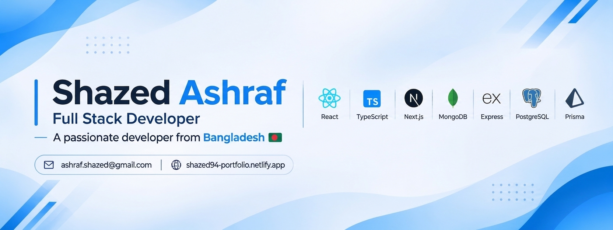
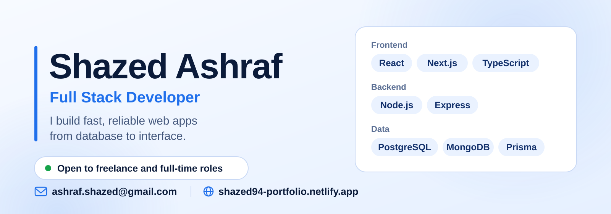

<!-- ===================== ANIMATED BANNER ===================== -->

  

<!-- <picture>
  <source media="(prefers-color-scheme: dark)" srcset="./banner/banner-dark.svg">
  
</picture> -->

  <picture>
    <source
      media="(prefers-color-scheme: dark)"
      srcset="https://readme-typing-svg.herokuapp.com?font=Fira+Code&size=24&duration=5000&pause=800&color=00F7FF&center=true&vCenter=true&width=700&lines=Full+Stack+Developer;React+%7C+TypeScript+%7C+Next.js;Building+Modern+Web+Applications;Always+Learning+New+Things"
    />
    <source
      media="(prefers-color-scheme: light)"
      srcset="https://readme-typing-svg.herokuapp.com?font=Fira+Code&size=24&duration=5000&pause=800&color=2563EB&center=true&vCenter=true&width=700&lines=Full+Stack+Developer;React+%7C+TypeScript+%7C+Next.js;Building+Modern+Web+Applications;Always+Learning+New+Things"
    />
  </picture>

   

## 👨‍💻 About Me

- 💻 Passionate **Programmer & Web Developer**
- 🌱 Exploring **full-stack development, modern web frameworks, and scalable applications**
- 🚀 Love building **real-world projects**
- ⚡ Building **fast, responsive apps** with React, Next.js, and Tailwind CSS
- ☁️ Diving deep into **cloud technologies** like AWS, Docker, and CI/CD pipelines
- 🧠 Curious • Consistent • Creative
   

---

## 🌐 Connect With Me

   

---

## 💻 Tech Stack:

                                    

---

## 📊 GitHub Stats:

The contribution card covers the past year and updates daily before the automated commit. A streak remains active through the current UTC day if the last contribution was yesterday; GitHub may take time to show new contributions.

<!-- !--  
 
 -->

<!-- Statistics: Commits -->
<picture>
  <source 
    srcset="https://raw.githubusercontent.com/Shazed94/Shazed94/main/output/stats_commits.svg#gh-dark-mode-only" 
    media="(prefers-color-scheme: dark)">
  <source 
    srcset="https://raw.githubusercontent.com/Shazed94/Shazed94/main/output/stats_commits.svg#gh-light-mode-only" 
    media="(prefers-color-scheme: light)">
  
</picture>

<!-- Statistics: Programming languages -->
<picture>
  <source 
    srcset="https://raw.githubusercontent.com/Shazed94/Shazed94/main/output/stats_langs.svg#gh-dark-mode-only" 
    media="(prefers-color-scheme: dark)">
  <source 
    srcset="https://raw.githubusercontent.com/Shazed94/Shazed94/main/output/stats_langs.svg#gh-light-mode-only" 
    media="(prefers-color-scheme: light)">
  
</picture>

<!-- Statistics: General statistics -->
<picture>
  <source 
    srcset="https://raw.githubusercontent.com/Shazed94/Shazed94/main/output/stats_general.svg#gh-dark-mode-only" 
    media="(prefers-color-scheme: dark)">
  <source 
    srcset="https://raw.githubusercontent.com/Shazed94/Shazed94/main/output/stats_general.svg#gh-light-mode-only" 
    media="(prefers-color-scheme: light)">
  
</picture>

<!-- Statistics: Unique repository visitors -->
<picture>
  <source 
    srcset="https://raw.githubusercontent.com/Shazed94/Shazed94/main/output/stats_visitors.svg#gh-dark-mode-only" 
    media="(prefers-color-scheme: dark)">
  <source 
    srcset="https://raw.githubusercontent.com/Shazed94/Shazed94/main/output/stats_visitors.svg#gh-light-mode-only" 
    media="(prefers-color-scheme: light)">
  
</picture>

---

## 🐍 Contribution Snake

 <picture>
    <source media="(prefers-color-scheme: dark)" srcset="https://raw.githubusercontent.com/Shazed94/Shazed94/output/github-contribution-grid-snake-dark.svg">
    <source media="(prefers-color-scheme: light)" srcset="https://raw.githubusercontent.com/Shazed94/Shazed94/output/github-contribution-grid-snake.svg">
    
  </picture>

---

<!-- ===================== FOOTER ===================== -->

